# Thư viện ảnh 3D AI Chíp Chíp & Biểu tượng

Tổng hợp kết quả tạo ảnh bằng Gemini AI Image Generator theo đúng phong cách 3D đồ chơi đất sét/nhựa bóng mềm, ánh sáng studio và nền trắng tinh.

---

## 1. Bộ ảnh Chíp Chíp (7/7 ảnh hoàn thành)

### 1.1. Đứng thẳng, vẫy một cánh, mỉm cười thân thiện
- **File**: [bird_character_waving_1794496933829.jpg](generated/bird_character_waving_1794496933829.jpg)
- **Pose**: `standing straight, facing the viewer, waving one wing, friendly smile`

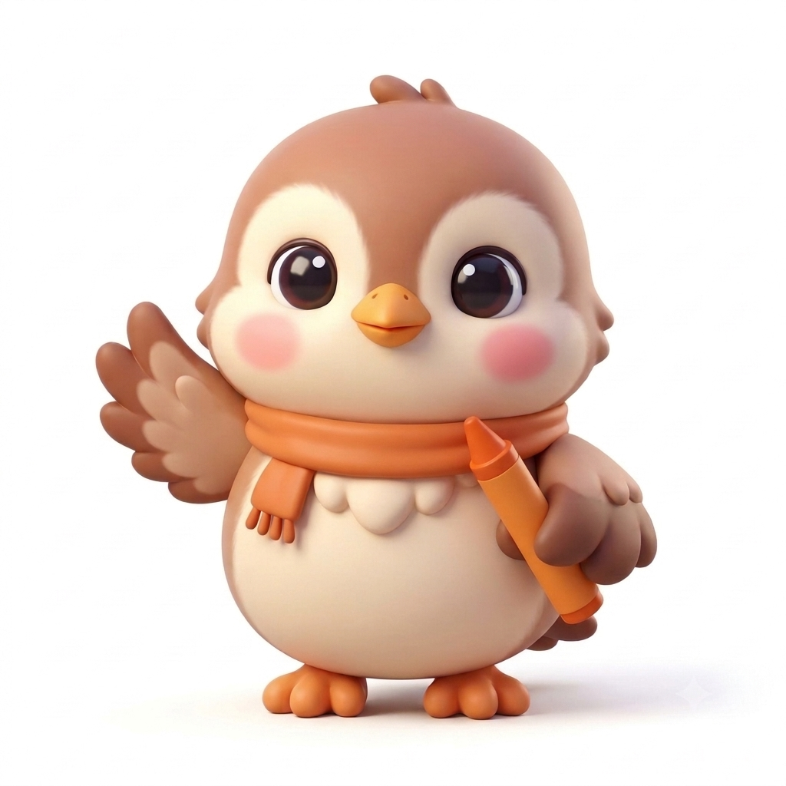

---

### 1.2. Nhảy lên vui mừng, giơ hai cánh, mắt nhắm tít, cười rạng rỡ
- **File**: [sparrow_jumping_joy_1794496984033.jpg](generated/sparrow_jumping_joy_1794496984033.jpg)
- **Pose**: `jumping with joy, both wings up, eyes closed happily, big smile`

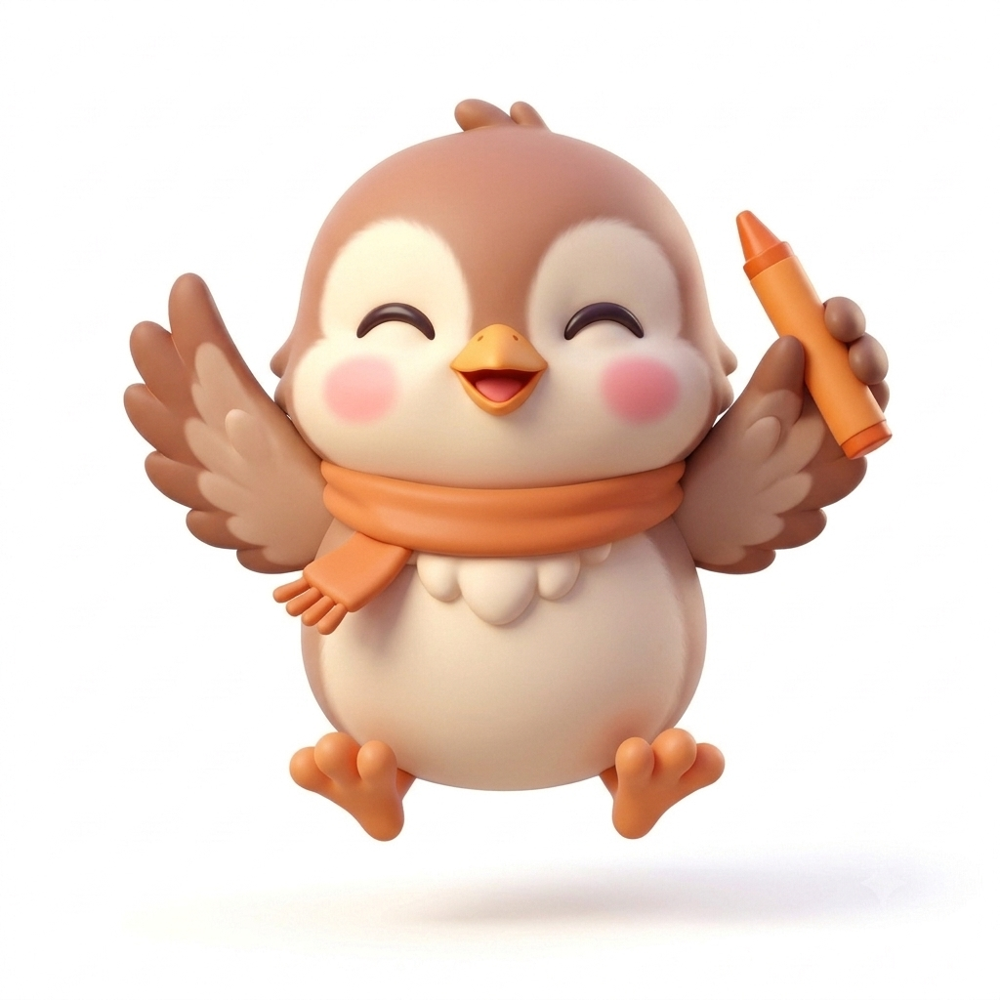

---

### 1.3. Giơ ngón cái (like) tự hào
- **File**: [sparrow_thumbs_up_1794496985337.jpg](generated/sparrow_thumbs_up_1794496985337.jpg)
- **Pose**: `giving a thumbs up with one wing, proud warm smile`

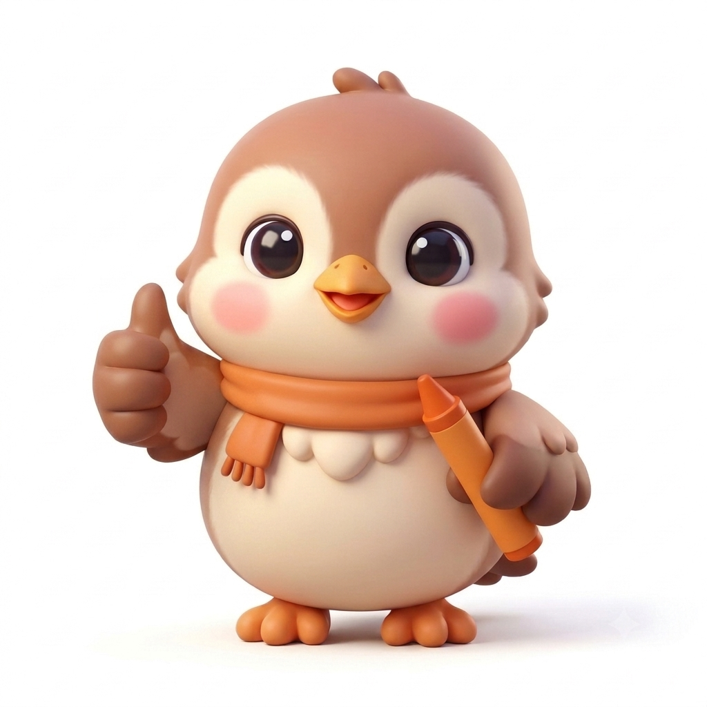

---

### 1.4. Ngạc nhiên, hai cánh ôm má, mỏ mở tròn
- **File**: [surprised_sparrow_character_1794497071327.jpg](generated/surprised_sparrow_character_1794497071327.jpg)
- **Pose**: `surprised, wings on cheeks, round open beak`

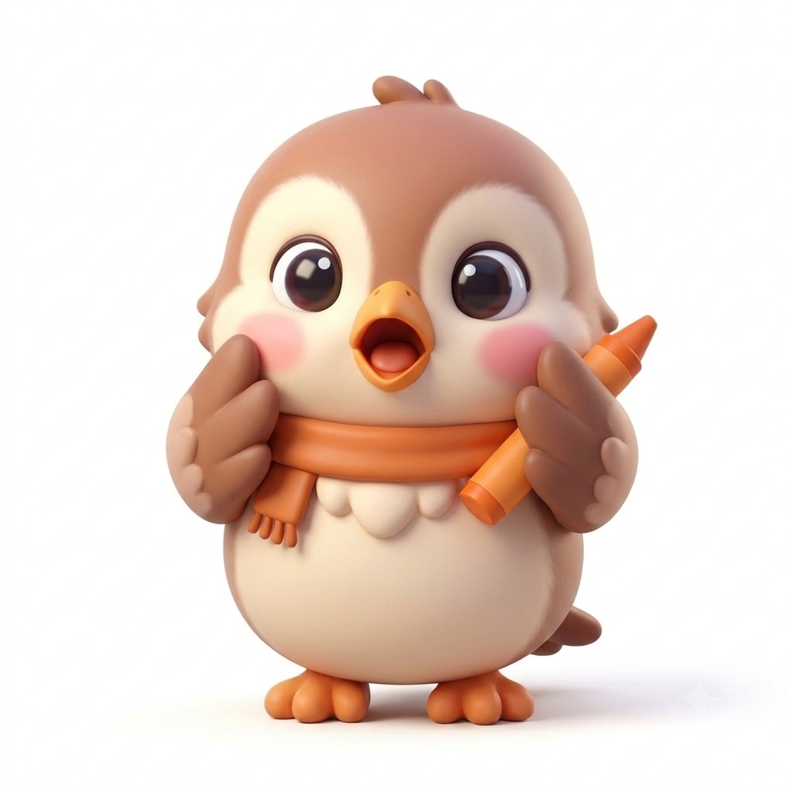

---

### 1.5. Khích lệ nhẹ nhàng, đầu hơi nghiêng, nụ cười hiền hậu, một cánh giơ lên
- **File**: [encouraging_bird_character_tilted_1794497007067.jpg](generated/encouraging_bird_character_tilted_1794497007067.jpg)
- **Pose**: `gently encouraging, head slightly tilted, soft kind smile, one wing raised`

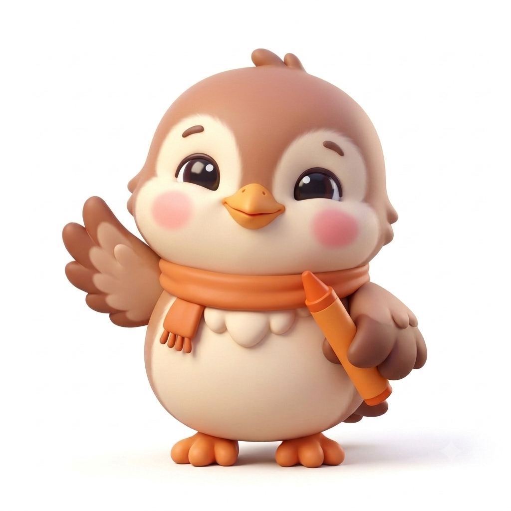

---

### 1.6. Buồn ngủ, ngáp ngủ, mắt lim dim, đội mũ ngủ cam nhỏ, ôm bút sáp như gối
- **File**: [sleepy_bird_crayon_1794496985338.jpg](generated/sleepy_bird_crayon_1794496985338.jpg)
- **Pose**: `sleepy, yawning, eyes half closed, tiny orange nightcap, hugging the crayon like a pillow`

---

### 1.7. Ngồi dưới đất cầm bút vẽ nét lượn sóng cam to, gương mặt tập trung vui vẻ
- **File**: [cute_bird_drawing_orange_crayon_1794496981331.jpg](generated/cute_bird_drawing_orange_crayon_1794496981331.jpg)
- **Pose**: `sitting on the ground holding the crayon naturally like a pencil, drawing a big curvy orange line on the ground, focused happy face, three-quarter view`

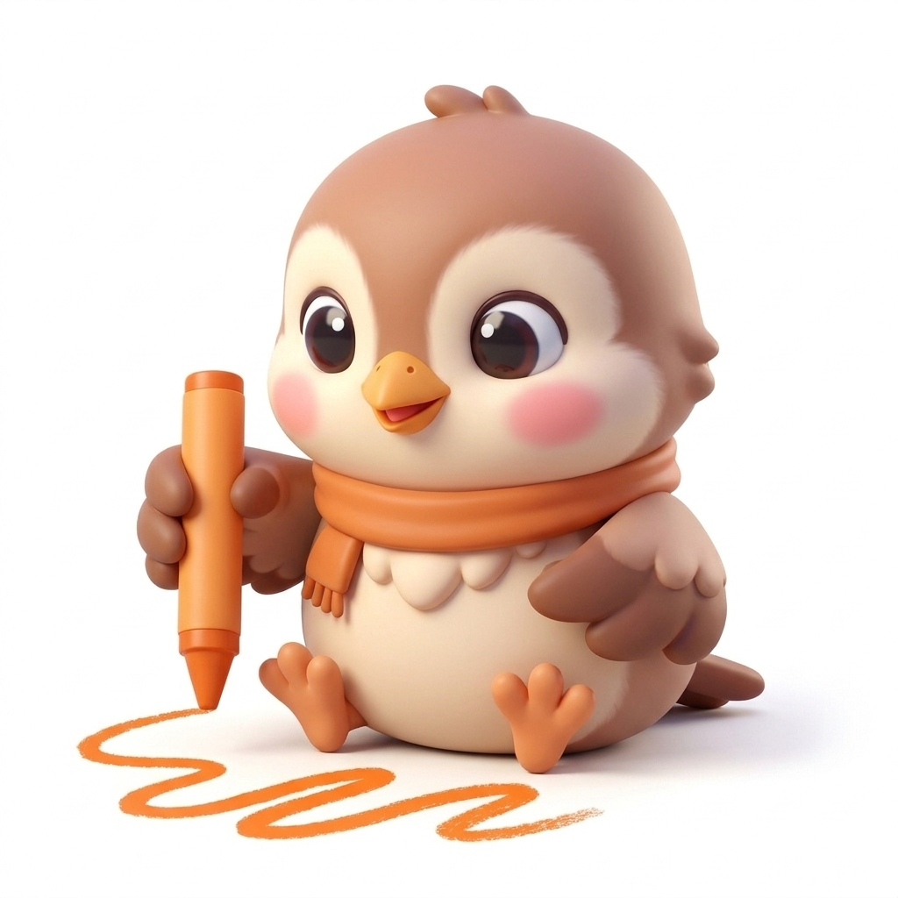

---

## 2. Bộ biểu tượng 3D (6/7 ảnh hoàn thành)

### 2.1. Bút sáp cam mập mạp vẽ một nét xoắn cam
- **File**: [chunky_orange_crayon_1794496997229.jpg](generated/chunky_orange_crayon_1794496997229.jpg)
- **Object**: `a chunky orange crayon drawing a curly orange line`

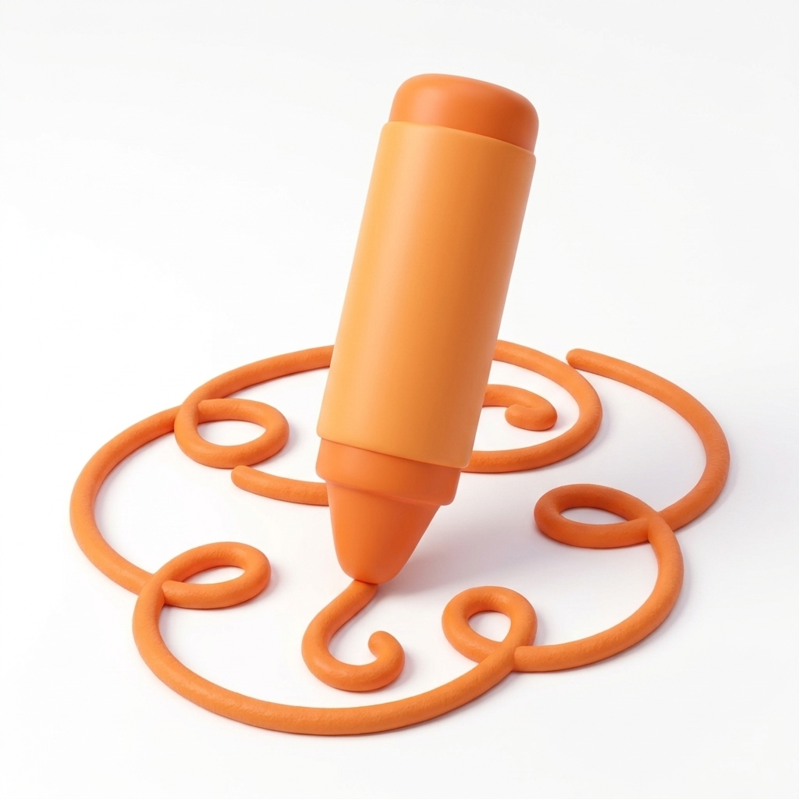

---

### 2.2. Ba khối chữ xếp chồng A, Ă, B (tím và hồng)
- **File**: [letter_blocks_a_a_b_1794497001524.jpg](generated/letter_blocks_a_a_b_1794497001524.jpg)
- **Object**: `three stacked toy letter blocks showing A, Ă and B, purple and pink`

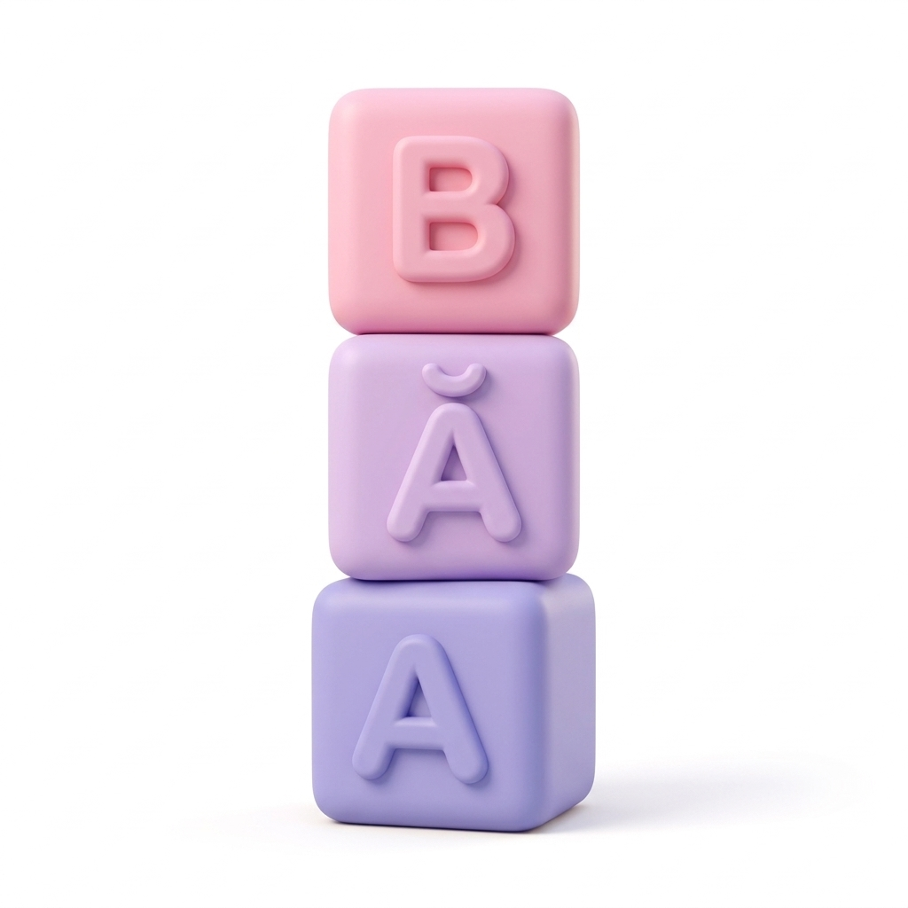

---

### 2.3. Khối số 1, 2, 3 bên cạnh bàn tính cầu vồng nhỏ (tông xanh dương)
- **File**: [math_toy_blocks_abacus_1794496994158.jpg](generated/math_toy_blocks_abacus_1794496994158.jpg)
- **Object**: `toy number blocks 1, 2, 3 next to a small rainbow abacus, blue tones`

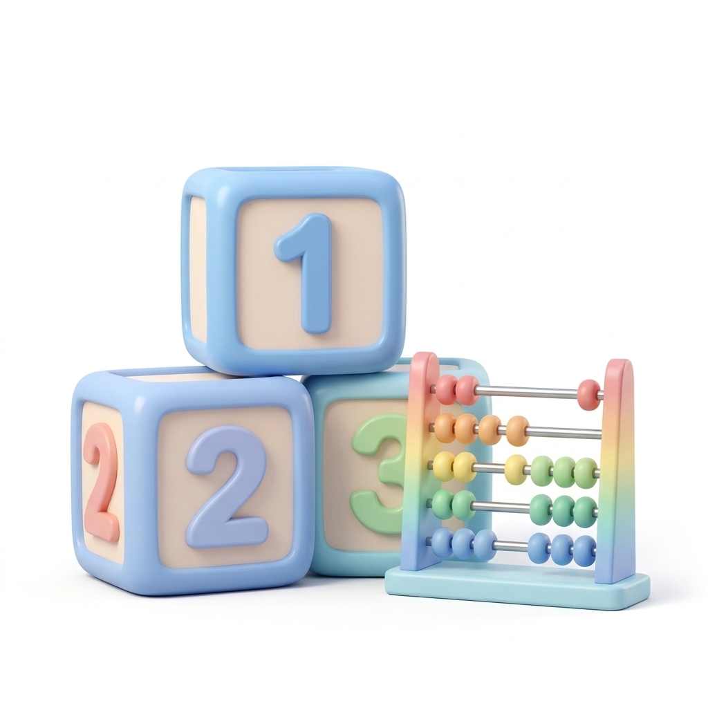

---

### 2.4. Chữ 3D bong bóng tròn A B C (xanh lá, vàng, mòng két)
- **File**: [abc_toy_letters_1794496994279.jpg](generated/abc_toy_letters_1794496994279.jpg)
- **Object**: `chunky bubbly 3D letters A B C, green, yellow and teal`

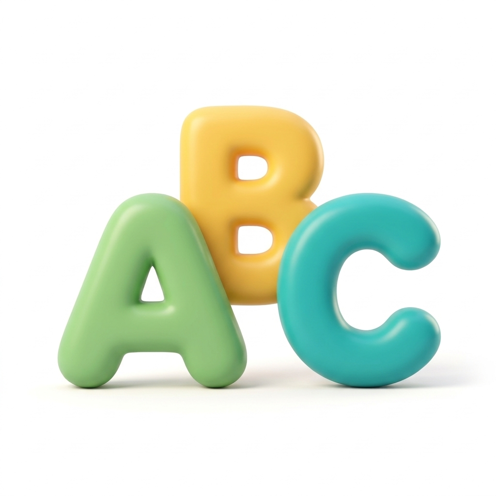

---

### 2.5. Ngôi sao vàng phồng tròn bóng bẩy
- **File**: [puffy_golden_star_1794497107824.jpg](generated/puffy_golden_star_1794497107824.jpg)
- **Object**: `a shiny chubby puffy golden star`

---

### 2.6. Vương miện đồ chơi vàng nhỏ nhắn có 3 viên ngọc tròn sắc màu
- **File**: [chubby_golden_toy_crown_1794497019105.jpg](generated/chubby_golden_toy_crown_1794497019105.jpg)
- **Object**: `a small chubby golden toy crown with three round colorful gems, no sparkle marks`

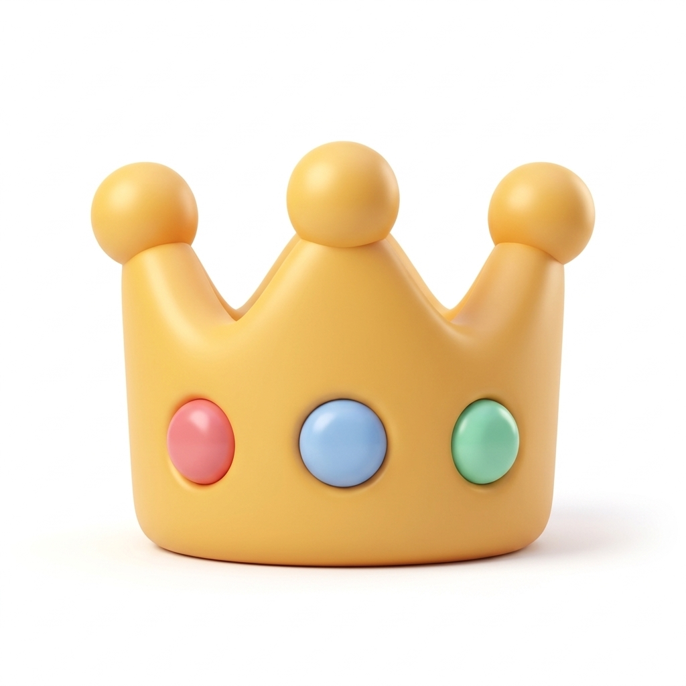

---

### 2.7. Ngọn lửa nhỏ tròn màu cam & vàng (`a cute small rounded flame, orange and yellow`)
> [!NOTE]
> Yêu cầu tạo ngọn lửa mới đã chạm giới hạn hạn mức (quota limit) của model `gemini-3.1-flash-image` (sẽ được reset sau vài giờ).
> Tuy nhiên, trong dự án hiện tại đã có sẵn bộ icon ngọn lửa hoàn chỉnh chất lượng cao tại:
> - [ic-flame.png](../../../../assets/images/ic-flame.png)
> - [2.0x/ic-flame.png](../../../../assets/images/2.0x/ic-flame.png)
> - [3.0x/ic-flame.png](../../../../assets/images/3.0x/ic-flame.png)
