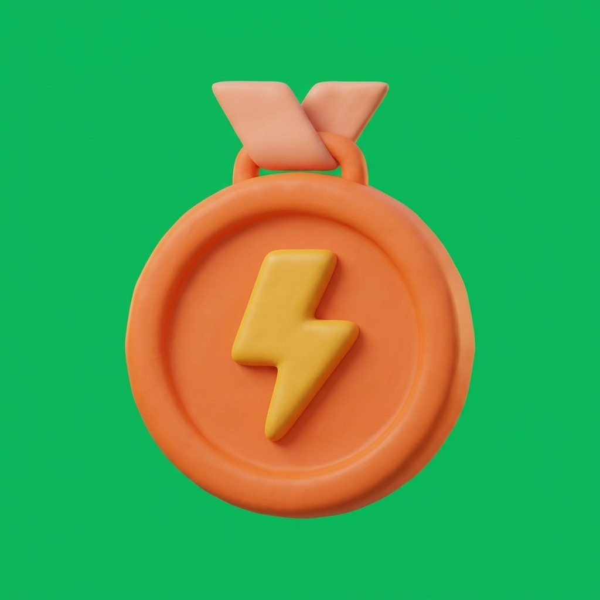
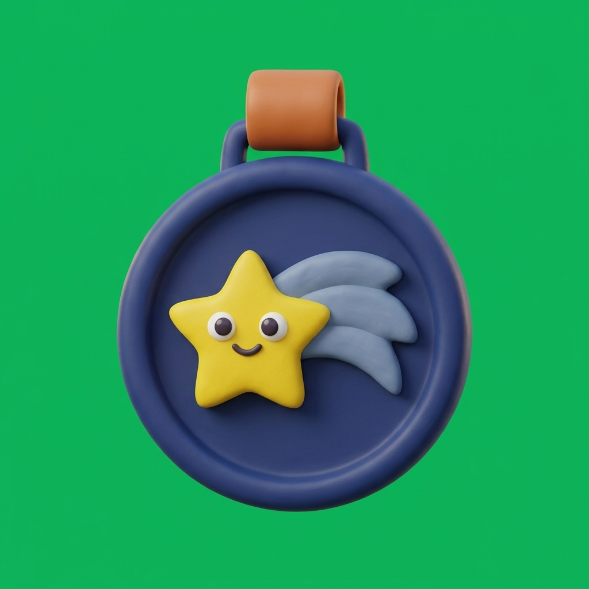
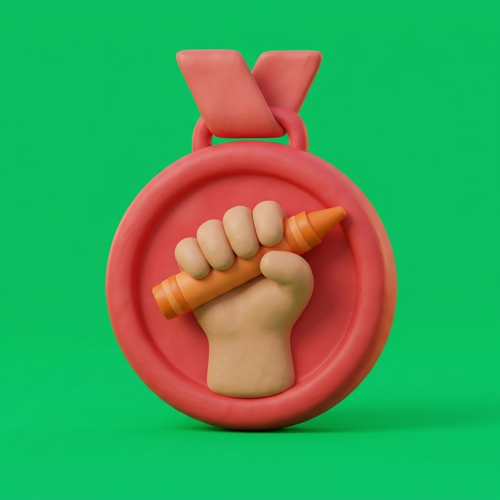
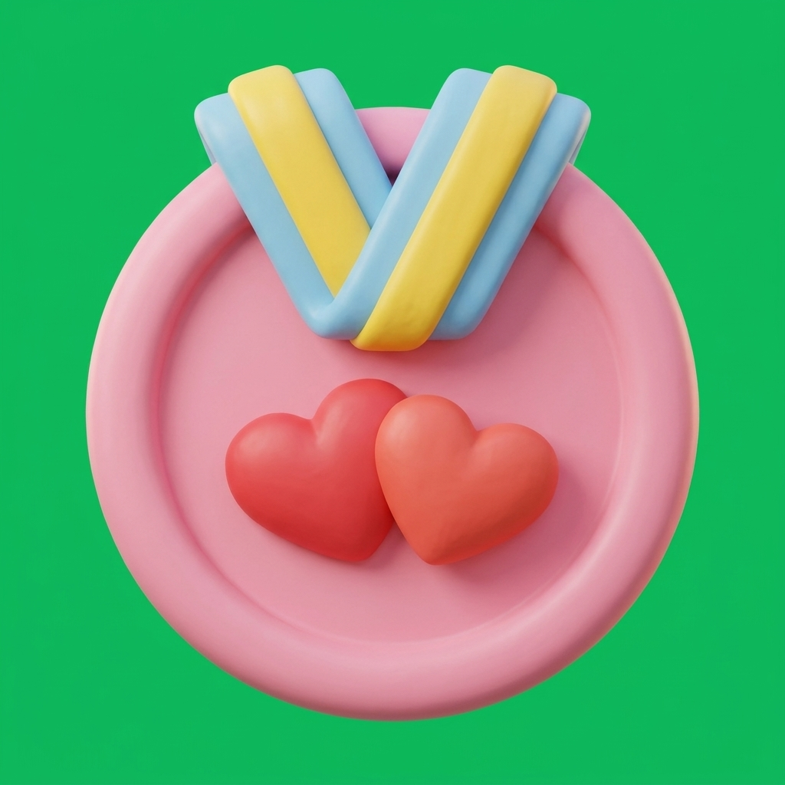
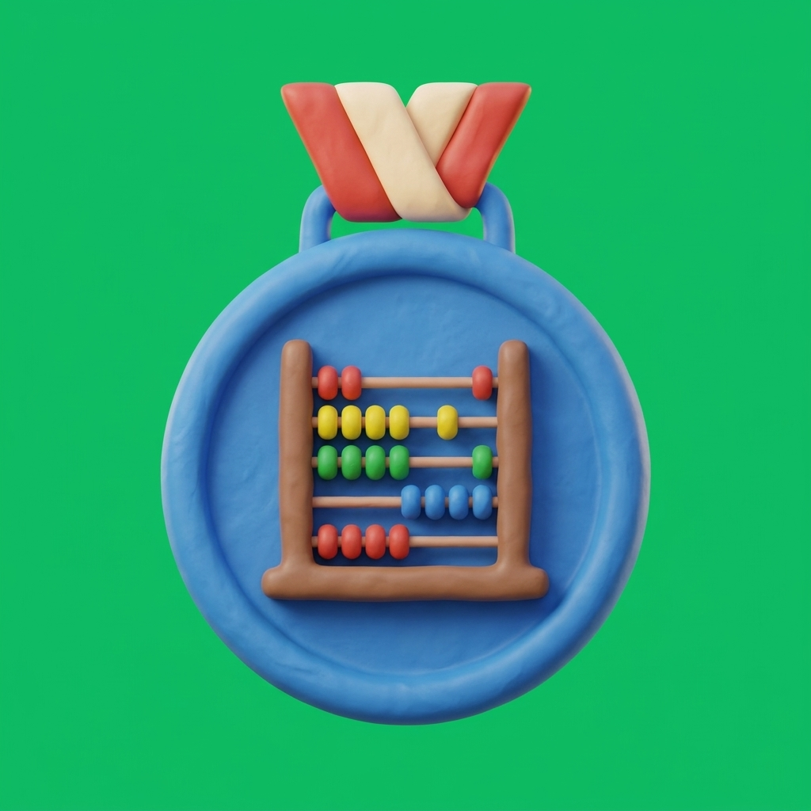
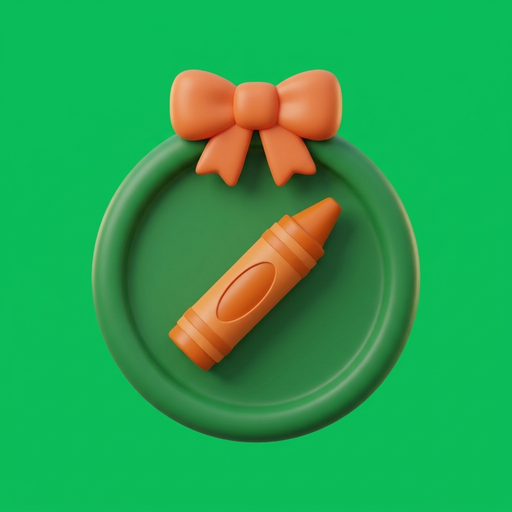
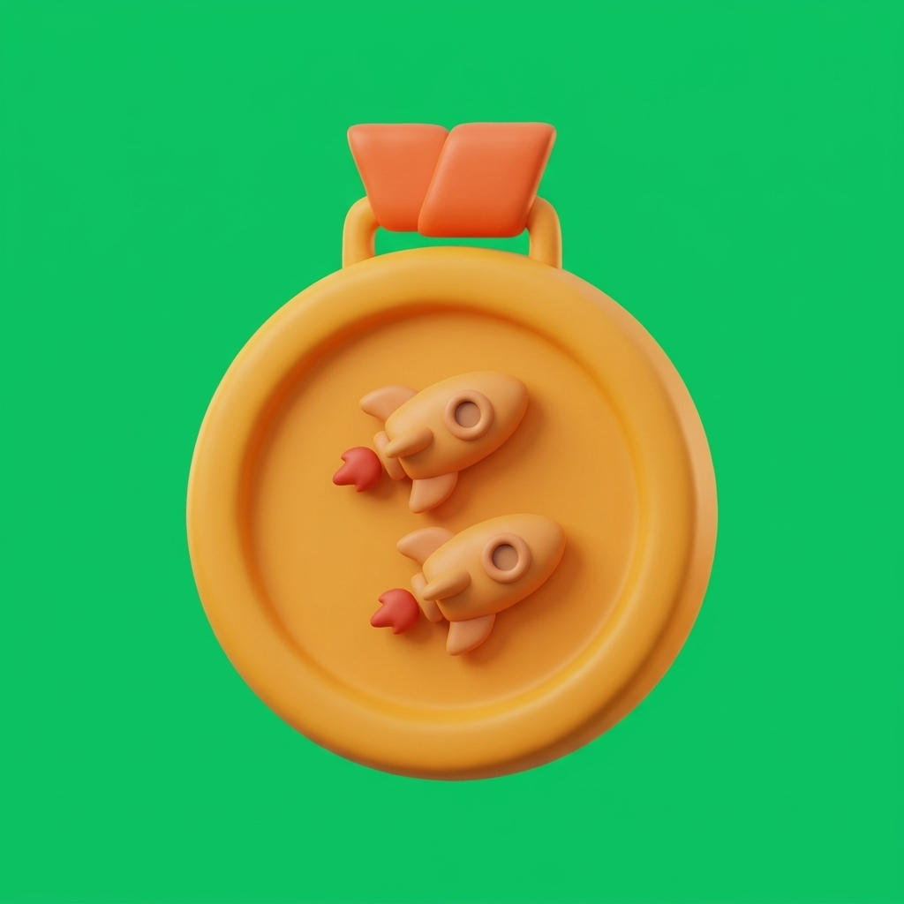
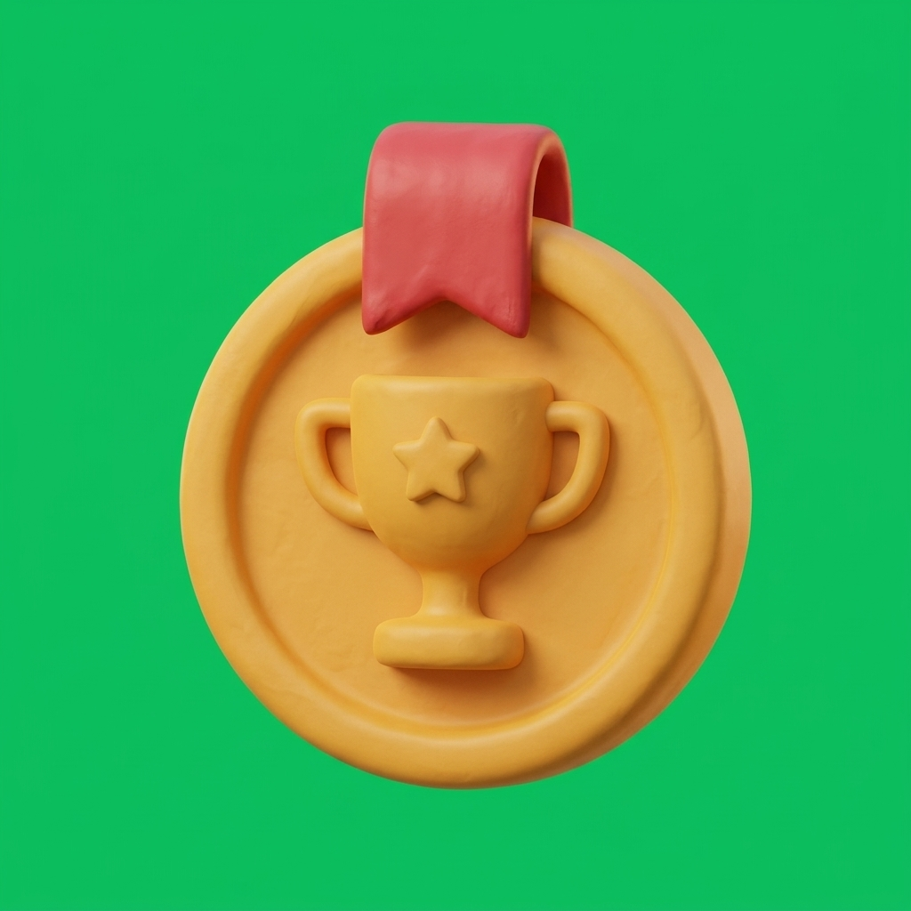
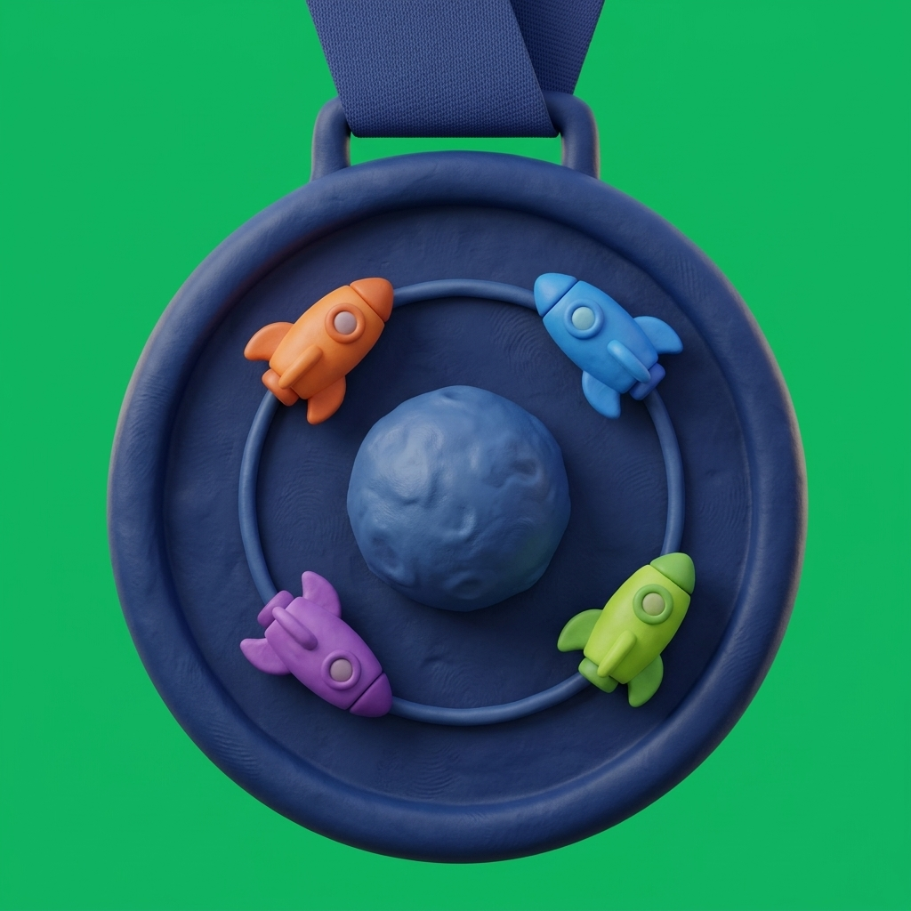

# Thư viện 8 Huy Hiệu 3D (3D Clay Medal Badges)

Tổng hợp bộ 8 huy hiệu / huy chương 3D phong cách đồ chơi đất sét mềm (soft 3D clay-toy style, matte surfaces, no glossy highlights, rounded chunky shapes, short ribbon, gentle studio light from top-left, nền xanh lá chuẩn `#00C853`) đồng bộ với nhân vật Chíp Chíp.

---

## 1. Vua Thần Tốc (King of Speed)
- **Tập tin**: [clay_lightning_badge_1794815094045.jpg](generated/medals/clay_lightning_badge_1794815094045.jpg)
- **Chủ đề**: `golden lightning bolt on an orange medal (Vua Thần Tốc)`
- **Mô tả**: Huy chương tròn dày màu cam bằng đất sét lì, nổi bật với biểu tượng tia sét vàng tươi, ruy-băng ngắn màu cam-vàng, đổ bóng nhẹ trên nền xanh lá `#00C853`.

---

## 2. Nhà Thông Thái (The Scholar)
- **Tập tin chính**: [nha_thong_thai_badge_v2_1794815178451.jpg](generated/medals/nha_thong_thai_badge_v2_1794815178451.jpg)
- **Biến thể**: [nha_thong_thai_badge_1794815158267.jpg](generated/medals/nha_thong_thai_badge_1794815158267.jpg)
- **Chủ đề**: `graduation cap on a purple medal (Nhà Thông Thái)`
- **Mô tả**: Huy chương đất sét màu tím với mũ tốt nghiệp cử nhân nổi khối kèm tua rua vàng rực rỡ, bề mặt mịn màng không bóng lóa.

---

## 3. Thợ Săn Sao Chổi (Comet Hunter)
- **Tập tin**: [comet_hunter_badge_1794815157174.jpg](generated/medals/comet_hunter_badge_1794815157174.jpg)
- **Chủ đề**: `smiling comet star on a navy medal (Thợ Săn Sao Chổi)`
- **Mô tả**: Huy chương đất sét xanh navy trầm ấm, tâm điểm là ngôi sao chổi mỉm cười thân thiện với đôi mắt tròn xoe và vệt đuôi vàng cong vút.

---

## 4. Không Bỏ Cuộc (Persistence)
- **Tập tin**: [medal_khong_bo_cuoc_1794815157707.jpg](generated/medals/medal_khong_bo_cuoc_1794815157707.jpg)
- **Chủ đề**: `small fist with a crayon on a red medal (Không Bỏ Cuộc)`
- **Mô tả**: Huy chương đất sét đỏ tươi thể hiện nhiệt huyết, đắp nổi hình nắm tay nhỏ nhắn siết chặt cây bút sáp màu, biểu trưng cho lòng kiên trì luyện viết vẽ của bé.

---

## 5. Bạn Thân Chíp Chíp (Best Friend of Chip Chip)
- **Tập tin chính**: [friendship_medal_badge_v2_1794815228873.jpg](generated/medals/friendship_medal_badge_v2_1794815228873.jpg)
- **Biến thể**: [friendship_medal_badge_1794815211978.jpg](generated/medals/friendship_medal_badge_1794815211978.jpg)
- **Chủ đề**: `two hearts on a pink medal (Bạn Thân Chíp Chíp)`
- **Mô tả**: Huy chương đất sét hồng pastel ngọt ngào với hai trái tim lồng vào nhau, ruy-băng gấp nếp xinh xắn.

---

## 6. Siêu Toán Học (Math Genius)
- **Tập tin**: [sieu_toan_hoc_badge_1794815196337.jpg](generated/medals/sieu_toan_hoc_badge_1794815196337.jpg)
- **Chủ đề**: `abacus on a blue medal (Siêu Toán Học)`
- **Mô tả**: Huy chương đất sét màu xanh dương với mô hình bàn tính gẩy học đếm hạt tròn ngộ nghĩnh, màu sắc tươi vui.

---

## 7. Bậc Thầy Chữ Cái (Alphabet Master)
- **Tập tin**: [clay_medal_badge_crayon_1794815200501.jpg](generated/medals/clay_medal_badge_crayon_1794815200501.jpg)
- **Chủ đề**: `orange crayon on a green medal (Bậc Thầy Chữ Cái)`
- **Mô tả**: Huy chương đất sét xanh lá ton-sur-ton với hình tượng cây bút sáp màu cam biểu tượng của chú chim Chíp Chíp.

---

## 8. Phi Công Chăm Chỉ (Hardworking Pilot)
- **Tập tin**: [badge_rocket_teal_1794815213547.jpg](generated/medals/badge_rocket_teal_1794815213547.jpg)
- **Chủ đề**: `rocket on a teal medal (Phi Công Chăm Chỉ)`
- **Mô tả**: Huy chương đất sét màu xanh ngọc (teal) với hình tên lửa mini mập mạp hướng thẳng lên trời, ruy-băng ngắn dễ thương.

---

## 9. Bạn Đua Vui Vẻ (Friend Racer)
- **Tập tin**: [clay_rocket_medal_badge_1795278433705.jpg](generated/medals/clay_rocket_medal_badge_1795278433705.jpg)
- **Chủ đề**: `two rockets in parallel on an orange medal (Bạn Đua Vui Vẻ)`
- **Mô tả**: Huy chương đất sét tròn dày màu vàng cam, nổi bật với hai chiếc tên lửa nhỏ bay song song, dải ruy-băng ngắn màu cam.

---

## 10. Nhà Vô Địch (Friend Champion)
- **Tập tin**: [clay_medal_badge_1795278435338.jpg](generated/medals/clay_medal_badge_1795278435338.jpg)
- **Chủ đề**: `trophy cup with a star on a gold medal (Nhà Vô Địch)`
- **Mô tả**: Huy chương vàng đất sét nổi khối chiếc cúp vô địch có ngôi sao tươi tắn, ruy-băng đỏ tươi.

---

## 11. Cuộc Đua Lớn (Big Race)
- **Tập tin**: [clay_space_medal_badge_png_1795278472125.jpg](generated/medals/clay_space_medal_badge_png_1795278472125.jpg)
- **Chủ đề**: `four colored rockets around a planet on a navy medal (Cuộc Đua Lớn)`
- **Mô tả**: Huy chương đất sét màu xanh navy với hành tinh ở trung tâm và bốn chiếc tên lửa mini bốn màu bay quanh vòng tròn quỹ đạo.

