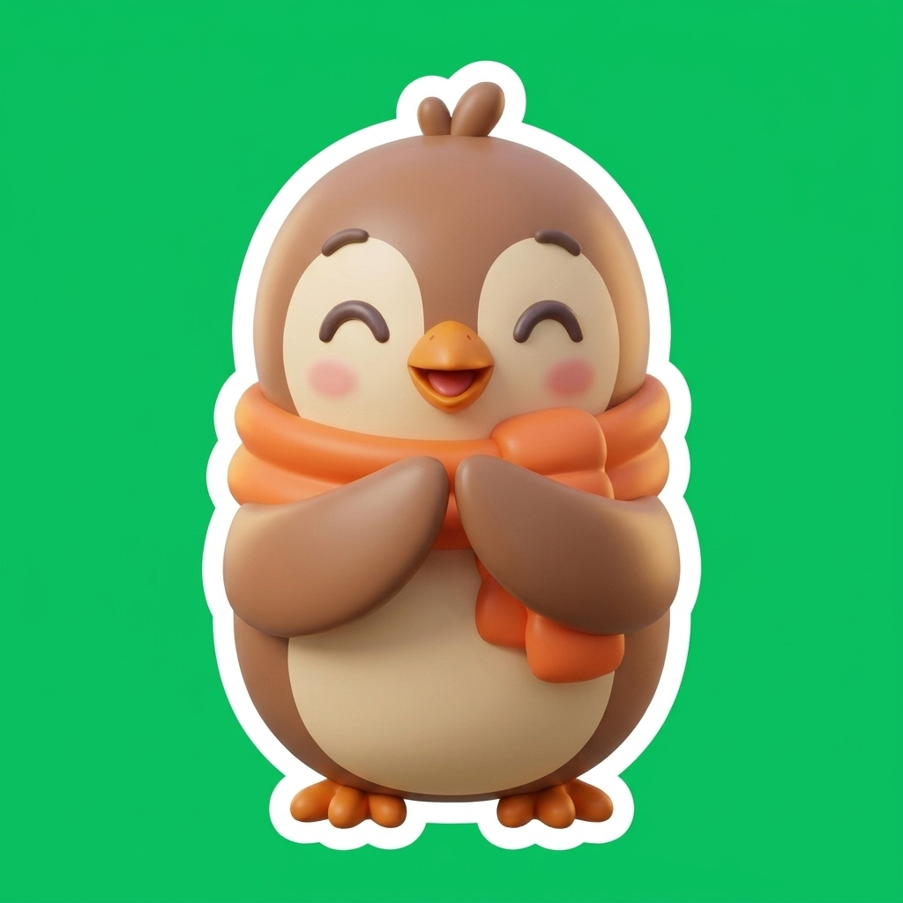
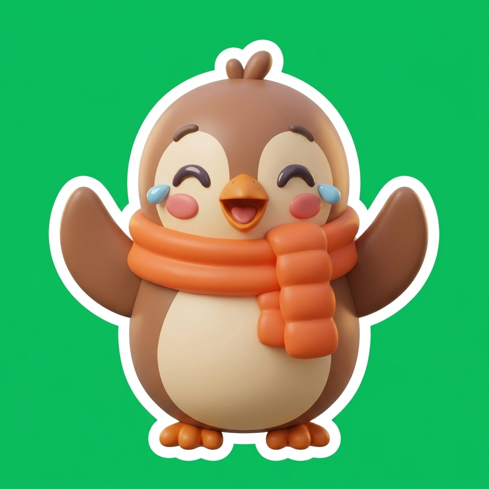
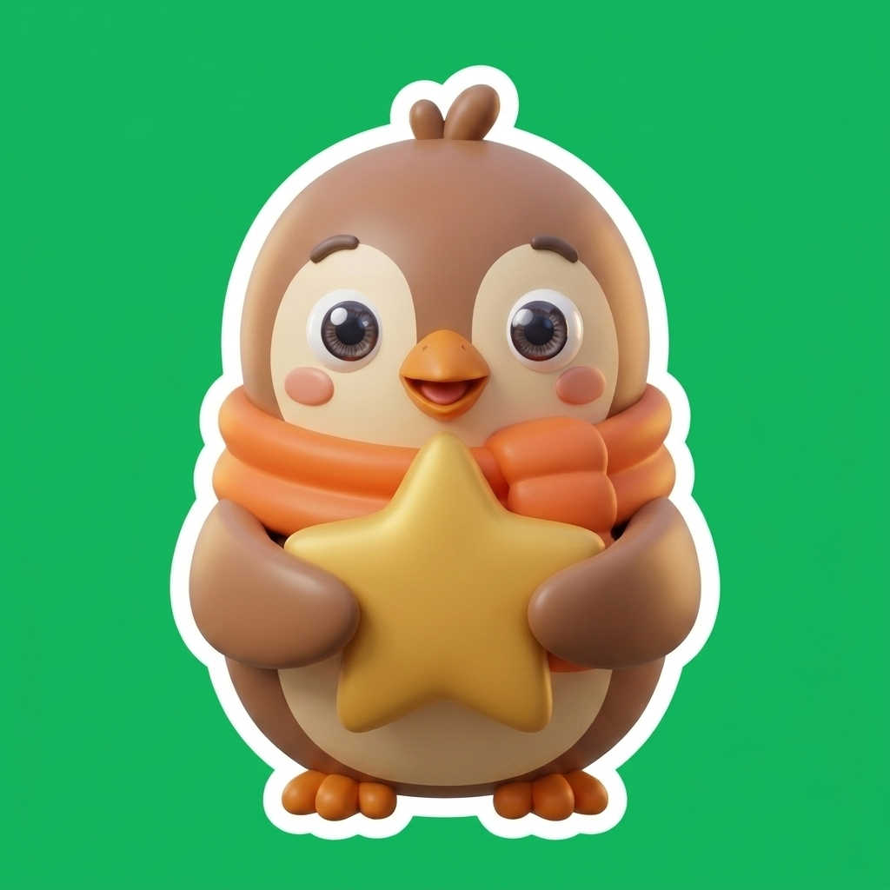
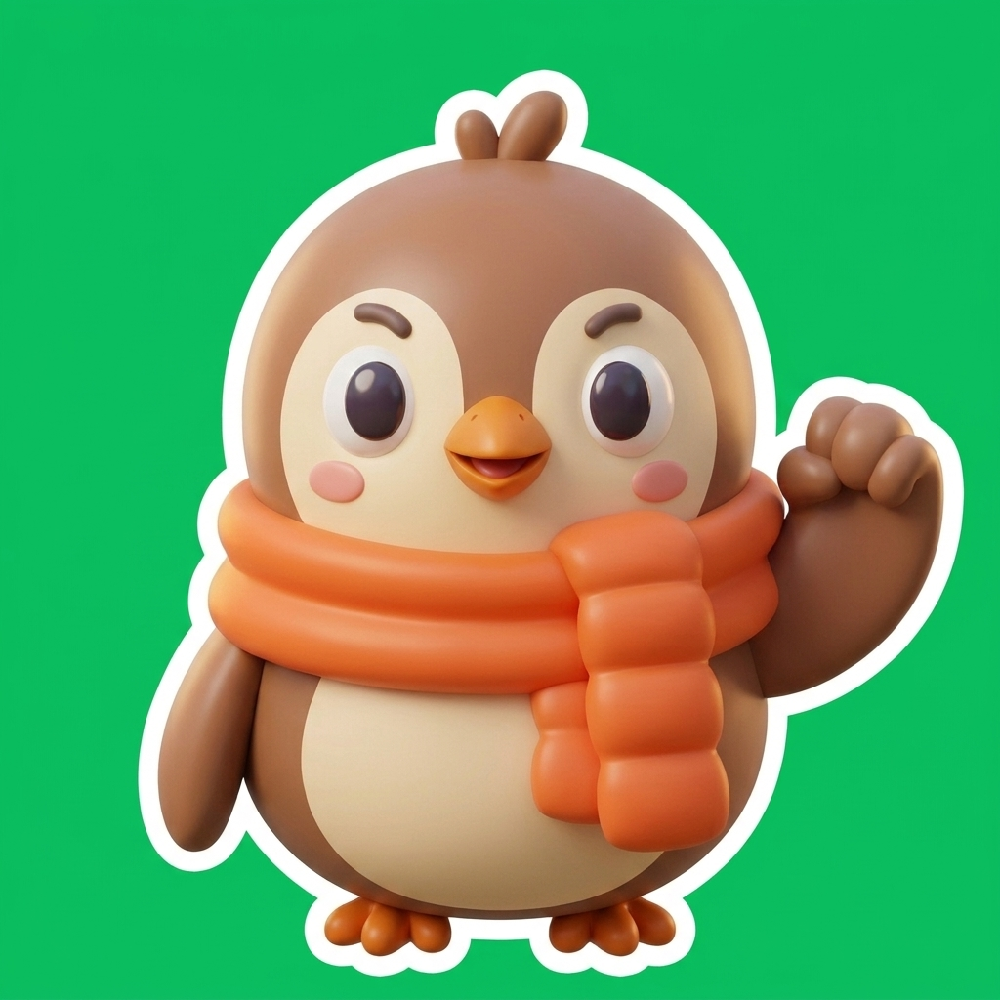
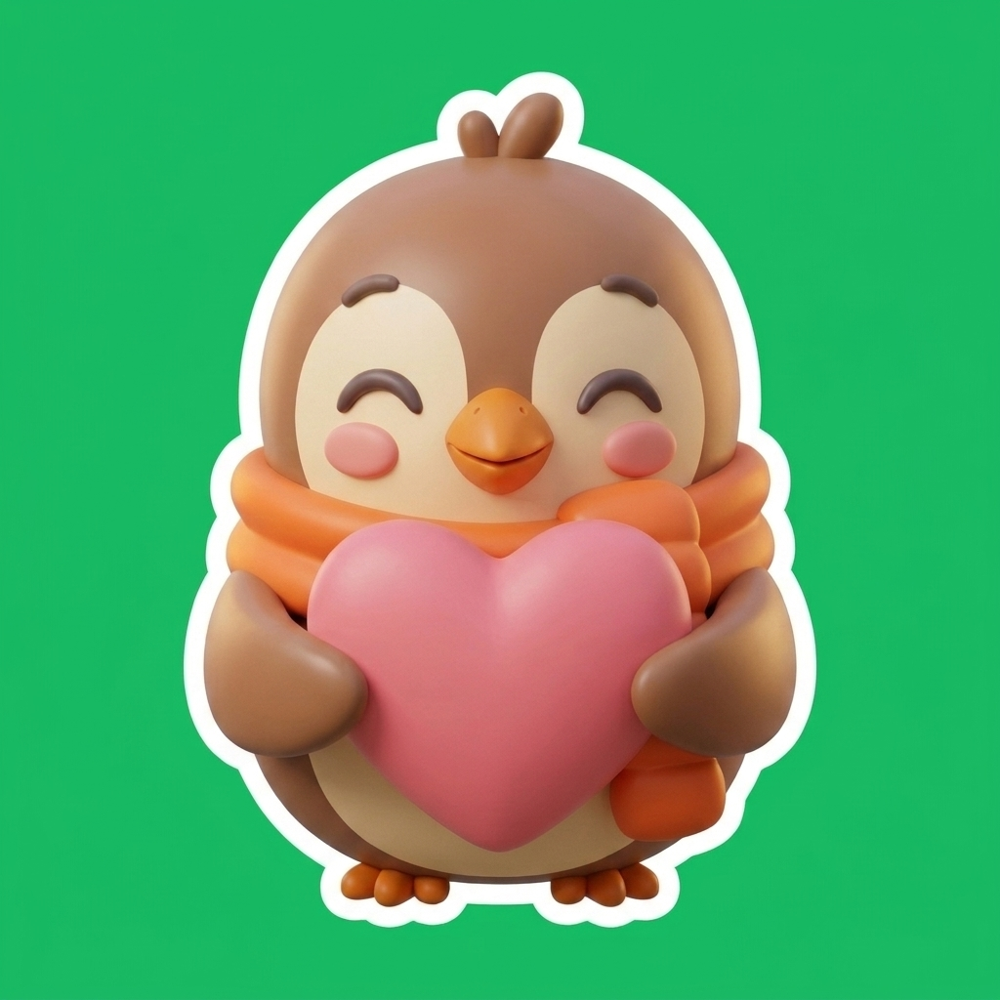
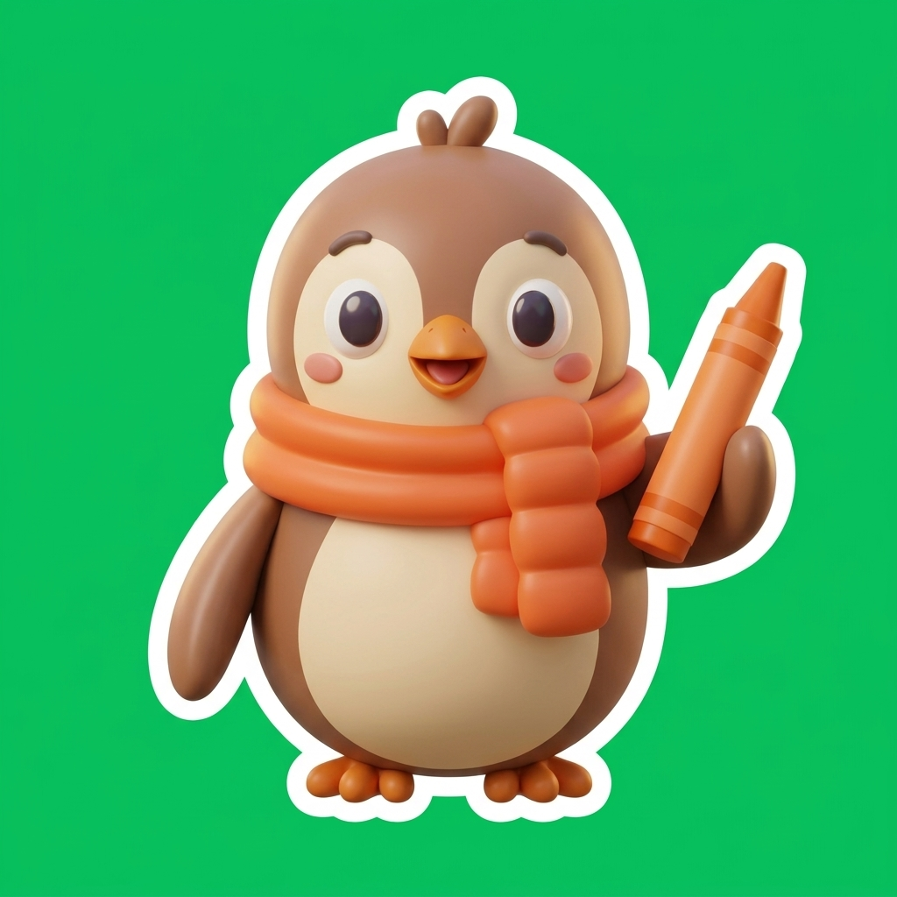
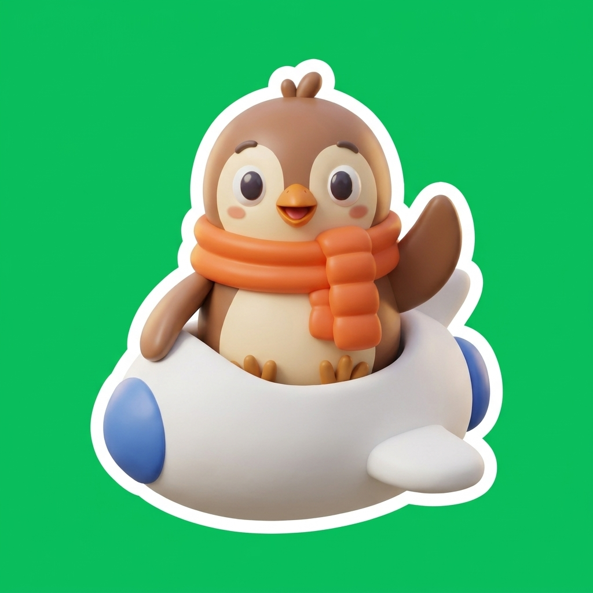

# Thư viện Album 10 Sticker Chíp Chíp (3D Clay Stickers)

Tổng hợp bộ 10 sticker tạo hình nhân vật Chíp Chíp (chim sẻ nâu má hồng, khăn len cam, mắt tròn sáng) theo phong cách đồ chơi đất sét 3D mềm (soft 3D clay-toy style, studio lighting, viền trắng dày kiểu sticker, full body, nền xanh lá phẳng chuẩn `#00C853` để phục vụ công cụ tách nền chroma-key).

---

## 1. sticker_clap
- **Tập tin**: [sticker_clap.jpg](generated/stickers/sticker_clap.jpg)
- **Mô tả**: Vỗ cánh vui mừng, cười tít mắt hạnh phúc.
- **Prompt bổ sung**: `clapping its wings happily, eyes closed smiling`

---

## 2. sticker_laugh
- **Tập tin**: [sticker_laugh.jpg](generated/stickers/sticker_laugh.jpg)
- **Mô tả**: Cười sảng khoái, mỏ mở to, giọt nước mắt vui sướng tí hon.
- **Prompt bổ sung**: `laughing out loud, beak wide open, tiny happy tears`

---

## 3. sticker_pilot_goggles
- **Tập tin**: [sticker_pilot_goggles.jpg](generated/stickers/sticker_pilot_goggles.jpg)
- **Mô tả**: Đội kính phi công tròn trên đầu, tạo dáng giơ ngón tay cái (like).
- **Prompt bổ sung**: `wearing round pilot goggles on its head, thumbs up`

---

## 4. sticker_grad_cap
- **Tập tin**: [sticker_grad_cap.jpg](generated/stickers/sticker_grad_cap.jpg)
- **Mô tả**: Đội mũ tốt nghiệp cử nhân nhỏ nhắn có tua rua, tư thế tự hào.
- **Prompt bổ sung**: `wearing a small graduation cap with tassel, proud pose`

---

## 5. sticker_hug_star
- **Tập tin**: [sticker_hug_star.jpg](generated/stickers/sticker_hug_star.jpg)
- **Mô tả**: Ôm chặt một ngôi sao vàng bồng bềnh to tròn.
- **Prompt bổ sung**: `hugging a big puffy golden star`

---

## 6. sticker_fist
- **Tập tin**: [sticker_fist.jpg](generated/stickers/sticker_fist.jpg)
- **Mô tả**: Giơ một bên cánh nắm đấm quyết tâm "Bạn làm được mà!".
- **Prompt bổ sung**: `raising one wing like a fist, determined “you can do it” face`

---

## 7. sticker_hug_heart
- **Tập tin**: [sticker_hug_heart.jpg](generated/stickers/sticker_hug_heart.jpg)
- **Mô tả**: Ôm chặt một trái tim đất sét màu hồng lớn, mắt nhắm êm đềm.
- **Prompt bổ sung**: `hugging a big pink clay heart, eyes closed`

---

## 8. sticker_abacus
- **Tập tin**: [sticker_abacus.jpg](generated/stickers/sticker_abacus.jpg)
- **Mô tả**: Cầm chiếc bàn tính hạt màu đồ chơi xinh xắn.
- **Prompt bổ sung**: `holding a small colorful toy abacus`

---

## 9. sticker_crayon
- **Tập tin**: [sticker_crayon.jpg](generated/stickers/sticker_crayon.jpg)
- **Mô tả**: Cầm cây bút sáp màu cam to như cầm bút viết.
- **Prompt bổ sung**: `holding a big orange crayon like a pen`

---

## 10. sticker_wave_rocket
- **Tập tin**: [sticker_wave_rocket.jpg](generated/stickers/sticker_wave_rocket.jpg)
- **Mô tả**: Ngồi trong chiếc tên lửa đất sét trắng nhỏ nhắn, vẫy cánh chào.
- **Prompt bổ sung**: `sitting in a small white clay rocket, waving`

